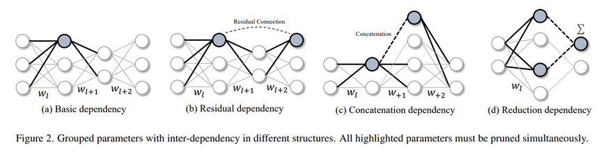
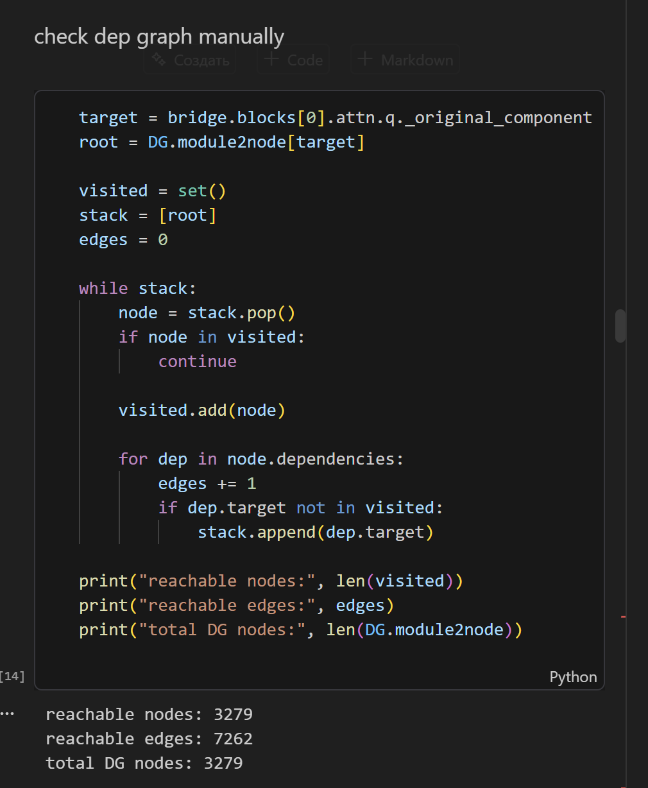
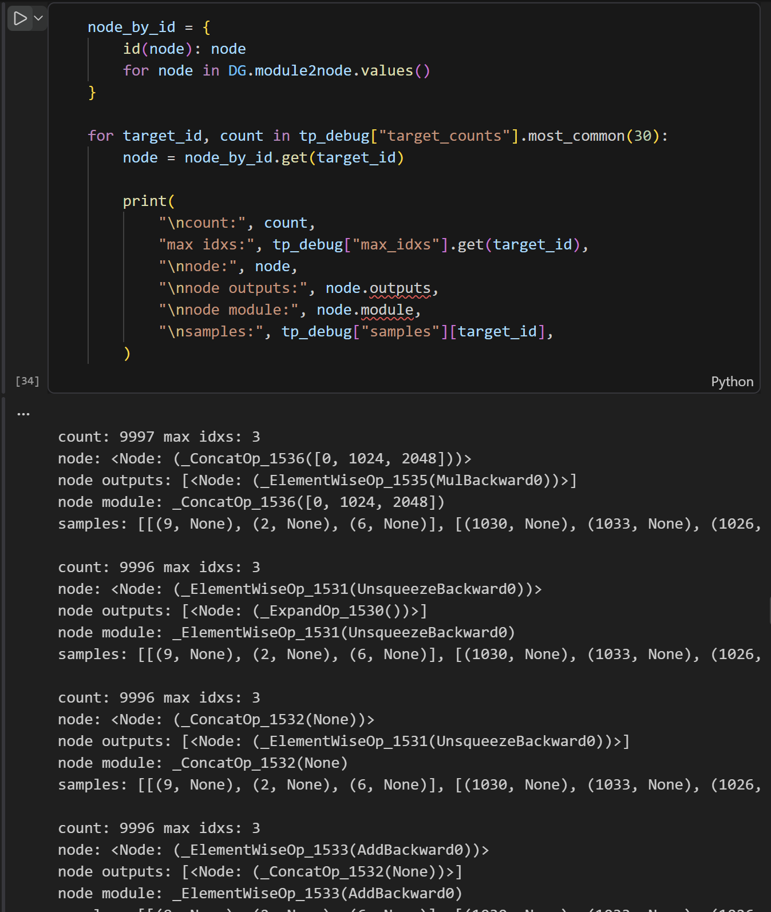

# Contribution to the Torch-Pruning Open-Source Project

## 1. Project proposal

### Chosen project

[Torch-Pruning](https://github.com/VainF/Torch-Pruning) is an open-source PyTorch library for structural neural-network pruning. It constructs a dependency graph from a model's autograd graph and uses it to propagate pruning operations between dependent layers and tensor operations. This makes it directly relevant to the course subject area: machine learning frameworks, neural-network optimization, and model compression.



### Selected issue

The selected task concerns incorrect processing of negative dimensions saved by PyTorch autograd for `torch.cat`. The problem was submitted upstream as [Torch-Pruning issue #532](https://github.com/VainF/Torch-Pruning/issues/532):

> Reading unsigned `grad_fn._saved_dim` leads to an incorrect comparison and an infinite loop for a `cat` operation in RoPE blocks.

The objective is to make Torch-Pruning interpret the saved concatenation dimension correctly and prevent `DependencyGraph.get_pruning_group()` from entering an infinite traversal loop for models containing Rotary Position Embedding (RoPE) operations.

## 2. Problem description

RoPE implementations commonly split a tensor and concatenate its transformed halves along the last dimension. A minimal example is:

```python
import torch

x = torch.randn(2, 3, 4, 5, requires_grad=True)

y = torch.cat(
    (x[..., :2], x[..., 2:]),
    dim=-1,
)

print(y.grad_fn)
print(y.grad_fn._saved_dim)
```

Although `torch.cat` receives `dim=-1`, the inspected PyTorch version exposes the saved value as:

```text
18446744073709551615
```

This number is `2**64 - 1`, which is the unsigned 64-bit representation of signed integer `-1`.

Torch-Pruning reads this internal value in `torch_pruning/dependency/index_mapping.py` and compares it with `constants.MAX_VALID_DIM`:

```python
if (
    hasattr(cat_node.grad_fn, "_saved_dim")
    and cat_node.grad_fn._saved_dim != 1
    and cat_node.grad_fn._saved_dim < constants.MAX_VALID_DIM
):
    return
```

With the default `MAX_VALID_DIM = 100`, the comparison is effectively:

```python
18446744073709551615 < 100
```

It evaluates to `False`, even though the logical dimension is only `-1`. Consequently, Torch-Pruning assigns an inappropriate concatenation index mapping to this node.

## 3. Impact of the defect

The defect was found while building a pruning group for an attention projection in a transformer model:

```python
group = DG.get_pruning_group(
    bridge.blocks[0].attn.q._original_component,
    tp.prune_linear_out_channels,
    idxs=[2, 6, 9],
)
```

Transformer attention graphs contain branches and joins around RoPE. Cycles in the dependency graph are therefore possible and are normally handled by Torch-Pruning's visited-dependency checks.

Because the erroneous concatenation mapping repeatedly shifts the pruning indices, each traversal of the cycle produces a new set. Conceptually, the sequence looks like this:

```text
[2, 6, 9]
[1026, 1030, 1033]
[2050, 2054, 2057]
...
```

The dependency is never recognized as already processed because its indices differ on every iteration. As a result, `get_pruning_group()` continues traversing the graph indefinitely and consumes increasing amounts of time and memory. During debugging, more than 100,000 traversal states were generated for a graph containing only a few thousand nodes.


*Too much nodes (operations) inside attention module. The usual amount should be ~ 100*




*Example of infinitie loop inside group. Code visits nodes many times (count=9997 for _ConcatOp) inside attention block.*

## 4. Investigation and root-cause analysis

The investigation consisted of the following stages:

1. The hang was reduced from a complete transformer pruning pipeline to a call to `DependencyGraph.get_pruning_group()`.
2. The dependency traversal was instrumented to record visited nodes, pruning operations, and propagated index sets.
3. The continually changing indices were traced to `_ConcatIndexMapping`.
4. The mapping was connected to the `_saved_dim` condition in `update_concat_index_mapping()`.
5. A minimal `torch.cat(..., dim=-1)` example confirmed that PyTorch returns the unsigned representation of `-1` through the private `grad_fn._saved_dim` attribute.

The root cause is therefore not an incorrectly constructed model graph. It is the interpretation of a signed dimension as an unsigned integer before applying Torch-Pruning's validity check.

The issue was reproduced with:

- PyTorch `2.10.0+cu128`;
- Torch-Pruning `1.6.0`;
- Python 3.10;
- a CUDA-enabled Linux environment.

## 5. Temporary workaround

Increasing the constant to cover the complete unsigned 64-bit range prevents the problematic mapping from being installed:

```python
MAX_VALID_DIM = 1 << 64
```

Then the following comparison becomes true:

```python
(2**64 - 1) < (2**64)
```

This removes the infinite loop in the reproduced case. However, it is only a workaround: it relies on the current internal representation used by PyTorch and does not restore the actual semantic value of the dimension.

## 6. Proposed implementation

The robust solution is to normalize the raw value to a signed integer before Torch-Pruning reasons about it. For a value stored as an unsigned 64-bit integer, the conversion can be expressed as:

```python
saved_dim = int(cat_node.grad_fn._saved_dim)

if saved_dim >= (1 << 63):
    saved_dim -= 1 << 64
```

For the reported case, this converts:

```text
18446744073709551615 -> -1
```

## 7. Open-source contribution status

The bug report, minimal reproducer, root-cause analysis, workaround, and proposed direction for a permanent correction were submitted to the Torch-Pruning repository as [issue #532](https://github.com/VainF/Torch-Pruning/issues/532).

At the time of writing, this report does not claim that a pull request has been accepted or approved by a project collaborator.

## 8. Results and lessons learned

This work identified a compatibility defect at the boundary between PyTorch autograd internals and Torch-Pruning's dependency analysis. A negative Python dimension was exposed through a private autograd attribute as an unsigned 64-bit value. A range check then selected the wrong index-mapping behavior, and the resulting changing indices defeated cycle detection.

The main practical outcome is a small reproducible example and a clear correction strategy. More generally, the investigation demonstrates why libraries should normalize framework-internal metadata before using it in graph algorithms and why termination tests are important for dependency graphs in modern transformer architectures.

## References

- [Torch-Pruning repository](https://github.com/VainF/Torch-Pruning)
- [Reported issue #532](https://github.com/VainF/Torch-Pruning/issues/532)
- [PyTorch `torch.cat` documentation](https://docs.pytorch.org/docs/stable/generated/torch.cat.html)
